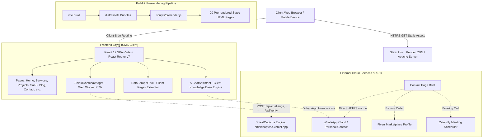
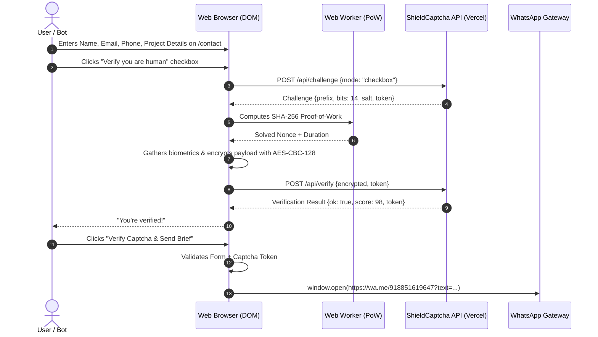

# PROJECT_MODEL: Code with Mr Singh (Tushar Singh Portfolio & Agency)

## 1. Project Overview & Core User Journeys
- **Primary Purpose**: High-performance professional freelance portfolio and agency marketing platform for Tushar Singh (MCA, MIT Pune; Full-Stack AI Engineer). Showcases AI automation workflows, smart conversational RAG bots, custom SaaS platforms (TASQ-ONE, Saathi Bot, ShieldCaptcha), commercial client deliverables, and technical guides.
- **User Roles**:
  1. **Anonymous Visitor / Prospective Client**: Browses services, deliverables, SaaS product pages, blog tutorials, testimonials, and interactive tools.
  2. **Qualified Inbound Lead**: Fills out the project brief on `/contact` or chats with `<AIChatAssistant />`, verifies human identity via ShieldCaptcha, and dispatches briefs directly to WhatsApp / Calendly / Fiverr escrow.
  3. **Technical Evaluator / Developer**: Tests interactive live demos (`DataScraperTool`, `ShieldCaptchaWidget`), inspects open-source packages, and reviews source code / case studies.
  4. **Search Engine Crawler & AI Retrieval Agent**: Ingests pre-rendered static HTML, `sitemap.xml`, `robots.txt`, `llms.txt`, and Schema.org JSON-LD graph.

---

## 2. Technology Stack & Versions
- **Language / Type System**: TypeScript `~5.8.2`
- **Frontend Framework**: React `^19.2.4`, React DOM `^19.2.4`, React Router DOM `^7.13.0`
- **Build Tool / Bundler**: Vite `^6.2.0`, `@vitejs/plugin-react` `^5.0.0`
- **Styling**: TailwindCSS `^3.4.17`, PostCSS `^8.5.26`, Autoprefixer `^10.5.4`
- **Client Utilities**: Lucide React `^0.563.0`, Fuse.js `^7.1.0`, React Helmet Async `^3.0.0`
- **Security / Bot Defense**: `shieldcaptcha` `^4.2.0`, Standalone `public/captcha.js` v4.2
- **Testing Engine**: Vitest `^4.1.4`, JSDOM `^29.0.2`, `@testing-library/react` `^16.3.2`, fast-check `^4.7.0`
- **Build / Run / Test Entry Points**:
  - `npm run dev`: Starts Vite local development server on port 3000 (`http://localhost:3000`).
  - `npm run build`: Executes `vite build` followed by `node scripts/prerender.js` (generates pre-rendered HTML for 20 routes in `dist/`).
  - `npm test`: Runs Vitest test suite (`vitest run`).
  - `npm run preview`: Starts Vite preview server for the `dist/` directory.

---

## 3. Architecture Diagram (Mermaid)

---

## 4. Complete Inventory

### A. Routes & Pages (Client-Side Navigation)
| Path | Method | Auth Required | Purpose & Key Components |
|---|---|---|---|
| `/` | GET | None | Homepage with hero, tech stack, client deliverables, testimonials, pricing, and FAQ |
| `/about` | GET | None | Developer background, credentials (MCA MIT Pune), tech stack, and experience |
| `/services` | GET | None | Catalog of services (AI automation, chatbots, web development, graphic design) |
| `/projects` | GET | None | Portfolio case studies (10+ deliverables with metrics) |
| `/saas` | GET | None | Proprietary SaaS suite directory |
| `/saas/tasq-one` | GET | None | TASQ-ONE intelligent task operating system showcase & architecture |
| `/saas/saathi-bot` | GET | None | Saathi Bot multilingual conversational RAG assistant & embed code |
| `/saas/shield-captcha` | GET | None | ShieldCaptcha Enterprise v4.2 autonomous bot defense showcase & live demo |
| `/blog` | GET | None | Technical engineering blog index |
| `/blog/:postId` | GET | None | 8 Technical deep dives & tutorials (SSG pre-rendered) |
| `/testimonials` | GET | None | Client reviews with aggregate rating schema |
| `/contact` | GET | None | Project intake form protected by ShieldCaptcha v4.2 with WhatsApp dispatch |
| `/sitemap` | GET | None | Comprehensive HTML site index and directory |
| `/404`, `*` | GET | None | Custom 404 error page with navigation quick links |

### B. Outbound Network & API Calls
| Endpoint / URL | Method | Purpose | Source Location |
|---|---|---|---|
| `https://shieldcaptcha.vercel.app/api/challenge` | POST | Requests SHA-256 PoW challenge | `public/captcha.js:1011` |
| `https://shieldcaptcha.vercel.app/api/verify` | POST | Verifies encrypted PoW payload & issues token | `public/captcha.js:1077` |
| `https://wa.me/918851619647` | GET | WhatsApp direct message dispatch | `pages/Contact.tsx:119`, `components/AIChatAssistant.tsx:142` |
| `https://calendly.com/...` | GET | External meeting scheduling | `pages/Contact.tsx`, `components/Navbar.tsx` |
| `https://www.fiverr.com/s/zAd5R2z` | GET | Escrow buyer protection hire links | `constants.tsx:21` |
| `https://www.google.com/maps/...` | GET | Public verified business office location link | `constants.tsx:32` |
| `${data-api}/api/widget/${botId}/...` | POST | Saathi Bot embed widget session & chat | `public/widget.js:713` |

### C. Environment Variables
- `PORT`: Server port for local Vite dev server (default: `3000`).
- `NODE_ENV`: Runtime mode (`production` vs `development`).
- `VITE_APP_URL`: Canonical site URL (`https://codewithmrsingh.me`).
- `VITE_APP_SECONDARY_URL`: Secondary canonical mirror (`https://codewithtushar.me`).

### D. File Uploads, Webhooks, Background Jobs, DB Models
- **Database Tables/Models**: **NONE** in this repository (100% static JAMstack architecture; zero local database tables or ORM models).
- **File Uploads**: **NONE** (No file upload fields exist).
- **Background Jobs / Crons**: **NONE** (Static pre-rendering occurs during the `npm run build` step).
- **Webhooks**: **NONE** received by this repository.

---

## 5. Trust Boundaries and Data Flow

- **Untrusted Input Entry Points**:
  1. `/contact` form fields (`name`, `email`, `phone`, `company`, `message`, `country`): Sanitized on client, formatted into URI-encoded message string.
  2. `DataScraperTool`: Accepts arbitrary pasted text, applies regex parsing. Potential ReDoS vectors if regexes are unanchored or complex.
  3. `SearchBar`: Accepts search queries, passes to `fuse.js`.
  4. `public/widget.js` & `public/captcha.js`: Standalone third-party embed scripts running in client DOM / Shadow DOM.
- **Sensitive Data & PII**:
  - Client contact briefs contain client email, phone, and project scope. These are strictly forwarded to WhatsApp and never stored in any persistent local DB in this repository.
  - Zero payment card, Stripe secret, or database credentials exist in this repo.

---

## 6. Deployment & Infrastructure
- **Render Static Sites (`render.yaml`)**:
  - Static publish path: `./dist`
  - Build command: `npm install && npm run build`
  - Headers: HSTS (`max-age=31536000; includeSubDomains; preload`), `X-Content-Type-Options: nosniff`, `X-Frame-Options: DENY`, `Permissions-Policy: camera=(), microphone=(), geolocation=()`.
  - Rewrite rules: `/* -> /index.html` (SPA fallback).
- **Apache (`.htaccess`)**:
  - RewriteEngine enabled with HTTPS enforcement and SPA fallback (`RewriteRule ^ /index.html [L]`).
  - Strict file protections denying direct access to `.env`, `.git`, `package.json`, `README.md`, `.htaccess`.
  - Headers: CSP, HSTS, X-Frame-Options, X-Content-Type-Options, Referrer-Policy.
- **Docker / Compose / CI**:
  - No Dockerfile or GitHub Actions CI workflows currently committed in root.

---

## 7. Open Questions and Architectural Assumptions

1. **Backend / API Server Scope**:
   - This repository currently contains a 100% static React 19 Single Page Application with static pre-rendering, with no backend Node server or database in the repo.
   - For **Phase 5 (Self-Defense + Monitoring layer)**, the prime directive specifies:
     * `MONITOR_DB = sqlite`
     * Rate limiting per IP and per account on login, signup, reset, and API routes
     * Honeypot routes (`/wp-admin`, `/.env`, `/.git/config`)
     * CLI `npm run security:events` to list and filter security events
   - **Question**: Should we create a Node.js security gateway / express reverse proxy server (e.g. `server.js` or `security-gateway.js`) that sits in front of the SPA or serves the build with SQLite monitoring, rate limiting, and honeypots, OR build the monitoring layer as a standalone security module/middleware in this project?
2. **Dynamic Penetration Testing Scope**:
   - The allowed target is `http://localhost:3000` (the currently running Vite dev server).
   - Are we permitted to run non-destructive security scans against `http://localhost:3000` once the test plan is approved?
3. **External Endpoint Requests**:
   - The application interacts with `https://shieldcaptcha.vercel.app` for bot verification.
   - Per Prime Directive 1 (AUTHORIZED SCOPE ONLY), we will NOT send security probes or scan traffic to `https://shieldcaptcha.vercel.app`. All dynamic penetration tests will target `http://localhost:3000` only.
