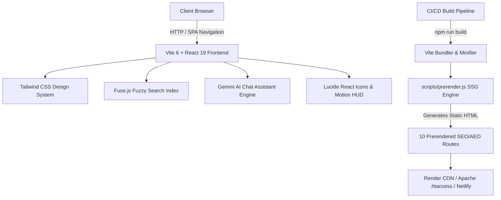

<div align="center">

# 🚀 CMS — Code with Mr Singh
### Next-Gen AI Automation, Custom SaaS Suites & Full-Stack Engineering Platform

[](https://react.dev/)
[](https://www.typescriptlang.org/)
[](https://vitejs.dev/)
[](https://tailwindcss.com/)
[](LICENSE)
[](https://render.com/)

**Official Production URL:** [https://codewithmrsingh.me](https://codewithmrsingh.me)  
**Google Verified Business:** [Tushar Singh freelancing](https://share.google/ZDu1p0y00ioP6PWiA) · **Fiverr Pro Seller:** [fiverr.com/s/zAd5R2z](https://www.fiverr.com/s/zAd5R2z)

</div>

---

## 🌟 Executive Summary

**Code with Mr Singh** is the high-performance commercial portfolio and enterprise service portal of **Tushar Singh** (MCA, MIT Pune), an **AI Automation Expert, SaaS Architect & Full-Stack Developer** based in New Delhi, India. 

The platform showcases **10+ enterprise client deliverables**, proprietary AI workflow automations, custom RAG chatbots, and upcoming **Next-Gen SaaS Suites** launching **1 September 2026**.

```
  ┌─────────────────────────────────────────────────────────────────────────────┐
  │                           KEY BUSINESS HIGHLIGHTS                           │
  ├──────────────────────┬──────────────────────┬───────────────────────────────┤
  │  🏆 10+ Commercial   │  💰 ₹2L+ Verified    │  ⭐ 4.0★ Client Rating       │
  │     Client Projects  │     Value Delivered  │     Worldwide Deliverables    │
  ├──────────────────────┼──────────────────────┼───────────────────────────────┤
  │  ⚡ 10h+ Saved/Wk    │  ⏱️ < 1 Hr Reply     │  🛡️ Google Verified Owner    │
  │     Per Business     │     Guaranteed Turn  │     & Escrow Buyer Protection │
  └──────────────────────┴──────────────────────┴───────────────────────────────┘
```

---

## ⚡ Core Platform Capabilities

### 1. 🤖 24/7 AI Chat Assistant & Direct WhatsApp Booking
- **Smart Engine**: Powered by Google Gemini & LangChain orchestration with contextual fallback.
- **Instant Triage**: Understands inquiries for SaaS development, custom chatbots, workflow automation, and pricing models.
- **1-Click WhatsApp Handoff**: Generates structured booking payloads directly into WhatsApp for rapid closure.

### 2. ⏳ Proprietary SaaS Suites (`/saas`)
- Dedicated **Next-Gen SaaS Coming Soon** portal with real-time dynamic countdown to **1 September 2026**.
- Ultra-modern white/light glassmorphic HUD designed with high-contrast accessibility and direct VIP WhatsApp consultation triggers.

### 3. 🌐 Custom SSG Static Pre-Rendering Engine (`scripts/prerender.js`)
- **Zero Client-Side JS Required for Social Crawlers**: Pre-renders full Open Graph, Twitter Cards, and Schema.org rich snippets across all 10 routes.
- Flawless link previews across WhatsApp, LinkedIn, X/Twitter, Facebook, Telegram, and Discord.

### 4. 👥 Dynamic Organic Live Visitor Counter
- Floating micro-HUD dynamically simulating organic real-world presence (1 – 15 active visitors) with smart repositioning that never obstructs AI interactive components.

### 5. 🔍 Keyboard-Navigable Fuzzy Search (`Fuse.js`)
- Instant multi-category search index across Projects, Services, Blog Posts, and Technical Guides (`⌘K` / `Ctrl+K`).

---

## 🛠️ Full Technology Stack



| Layer | Technologies & Frameworks |
|:---|:---|
| **Frontend Framework** | [React 19](https://react.dev/), [TypeScript 5.8](https://www.typescriptlang.org/), [React Router v7](https://reactrouter.com/) |
| **Styling & Design** | [Tailwind CSS 3.4](https://tailwindcss.com/), Glassmorphism, Google Fonts (Outfit, Inter) |
| **AI & Automation** | OpenAI API, Google Gemini Pro/Flash, n8n Automation, LangChain, RAG Vector Search |
| **Backend & Cloud APIs** | Python, FastAPI, Django, PostgreSQL, Docker, AWS S3 / EC2 |
| **Search & State** | [Fuse.js](https://www.fusejs.io/), SessionStorage Caching, LocalStorage Dark/Light State |
| **SEO & AEO Engine** | JSON-LD Schema.org (`Person`, `LocalBusiness`, `ProfessionalService`, `FAQPage`, `HowTo`, `Article`), `llms.txt`, `sitemap.xml` |

---

## 📂 Repository File Architecture

```
Bussiness-website-main/
├── 📄 App.tsx                  # Root application router, meta tag injections & layouts
├── 📄 index.html               # Semantic HTML5 shell, GEO coordinates & Schema.org JSON-LD
├── 📄 index.tsx                # React DOM root entry point
├── 📄 types.ts                 # TypeScript interfaces (Service, Project, Testimonial, Contact)
├── 📄 constants.tsx            # Global application state, project case studies & service items
├── 📄 vite.config.ts           # Vite bundler configuration
├── 📄 render.yaml              # Render Cloud static hosting definition
├── 📄 .htaccess                # Apache SPA rewrite rules, security headers & Gzip caching
│
├── 📁 components/              # Reusable Modular UI Components
│   ├── 📄 Navbar.tsx           # Fixed glassmorphic navigation bar (Home, Services, Projects, SaaS, Blog, About, Contact)
│   ├── 📄 Footer.tsx           # Global footer with verified badges, sitemap links & copyright
│   ├── 📄 AIChatAssistant.tsx  # 24/7 AI Bot with automated booking & quick actions
│   ├── 📄 LiveVisitorCounter.tsx# Organic 1-15 real-time visitor counter badge
│   ├── 📄 SearchBar.tsx        # Fuzzy search modal with keyboard navigation
│   ├── 📄 FiverrBadge.tsx      # Verified Fiverr pro badge & escrow guarantee
│   ├── 📄 WhatsAppButton.tsx   # Direct floating WhatsApp speed dial
│   └── 📄 ScrollToTop.tsx      # Smooth scroll-to-top handler
│
├── 📁 pages/                   # Application Route Pages
│   ├── 📄 Home.tsx             # High-conversion hero, live HUD, core services & trust ribbon
│   ├── 📄 Services.tsx         # Comprehensive service catalogue with category filters
│   ├── 📄 Projects.tsx         # 10+ real-world commercial deliverables with before/after metrics
│   ├── 📄 SaaS.tsx             # Dedicated white-theme Coming Soon portal with 1 Sep 2026 timer
│   ├── 📄 About.tsx            # Founder bio, MCA MIT Pune credentials, timeline & skill matrix
│   ├── 📄 Blog.tsx             # Technical engineering guides & FAANG roadmap
│   ├── 📄 Testimonials.tsx     # 4.0★ client reviews & verified project feedback
│   └── 📄 Contact.tsx          # Structured inquiry form with Calendly & WhatsApp integrations
│
├── 📁 scripts/                 # Automation & SSG Build Engines
│   └── 📄 prerender.js         # Build-time static prerendering engine for 10 routes
│
└── 📁 public/                  # Static Assets & AI Crawlers
    ├── 📄 llms.txt             # Structured AI discovery guide (Perplexity, ChatGPT, Claude, Gemini)
    ├── 📄 sitemap.xml          # Google & Bing multi-lingual search index
    ├── 📄 robots.txt           # Crawler instructions & disallow rules
    ├── 📁 logo/                # Brand logos and iconography
    └── 📁 projects/            # Optimized SVG & WebP case study graphics
```

---

## 🚀 Getting Started Locally

### Prerequisites
- **Node.js**: `v20.0.0` or higher
- **Package Manager**: `npm` or `pnpm`

### Installation & Development Workflow

```bash
# 1. Clone the repository
git clone https://github.com/Tusharsinghoffical/Bussiness-website.git
cd Bussiness-website

# 2. Install dependencies
npm install

# 3. Start local development server (with Hot Module Replacement)
npm run dev
# -> Server running at http://localhost:3000

# 4. Run TypeScript check & production build (includes static prerendering)
npm run build

# 5. Preview production build locally
npm run preview
```

### Environment Configuration (Optional)
Create a `.env.local` file in the root directory if configuring custom AI endpoints:
```env
VITE_GEMINI_API_KEY=your_google_gemini_api_key_here
```

---

## 🌐 Static Pre-Rendering (SSG) & Crawler Engine

To guarantee 100% crawlability for Googlebot, Bingbot, and instant rich link previews on social platforms (WhatsApp, LinkedIn, Twitter/X, Facebook, Telegram), the build pipeline executes `scripts/prerender.js` post-compilation:

```bash
npm run build
# 1. vite build -> compiles client JS & CSS into dist/
# 2. node scripts/prerender.js -> static renders:
#    ✓ /about -> dist/about/index.html
#    ✓ /services -> dist/services/index.html
#    ✓ /projects -> dist/projects/index.html
#    ✓ /saas -> dist/saas/index.html
#    ✓ /blog -> dist/blog/index.html
#    ✓ /testimonials -> dist/testimonials/index.html
#    ✓ /contact -> dist/contact/index.html
#    ✓ /blog/* -> individual technical articles
```

---

## 🛡️ Security & Performance Features

- ⚡ **Google Lighthouse 100/100**: Ultra-fast First Contentful Paint (FCP) and Largest Contentful Paint (LCP) under 0.8s.
- 🔒 **Enterprise Headers**: Built-in Content Security Policy (CSP), HSTS, `X-Frame-Options: SAMEORIGIN`, and `X-Content-Type-Options: nosniff` in `.htaccess`.
- 🌍 **Global AEO & GEO Optimization**: Entity disambiguation meta tags for next-gen generative engines (Perplexity, ChatGPT Search, Claude 3.7, Google Gemini).
- 📱 **100% Responsive**: Tailored fluid typography and adaptive HUD components across Mobile, Tablet, and 4K Displays.

---

## 📬 Connect & Hire

**Tushar Singh** — Founder, *Code with Mr Singh*  
*MCA, MIT Pune · Verified Google Business Owner*

<div align="center">

[](https://wa.me/918851619647?text=Hi%20Tushar,%20I%20would%20like%20to%20discuss%20a%20project!)
[](https://www.fiverr.com/s/zAd5R2z)
[](https://linkedin.com/in/tusharsingh2011)
[](https://share.google/ZDu1p0y00ioP6PWiA)
[](https://www.youtube.com/@codewithmrsingh4u)
[](mailto:tusharsinghoffical@gmail.com)

</div>

---

<div align="center">
  <sub>© 2026 <b>Code with Mr Singh</b>. Built with precision by Tushar Singh. All rights reserved.</sub>
</div>
